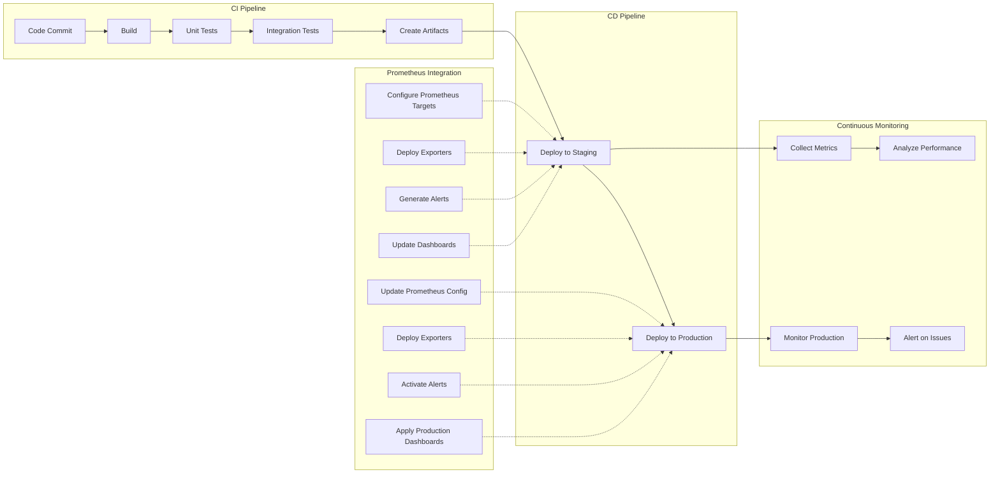
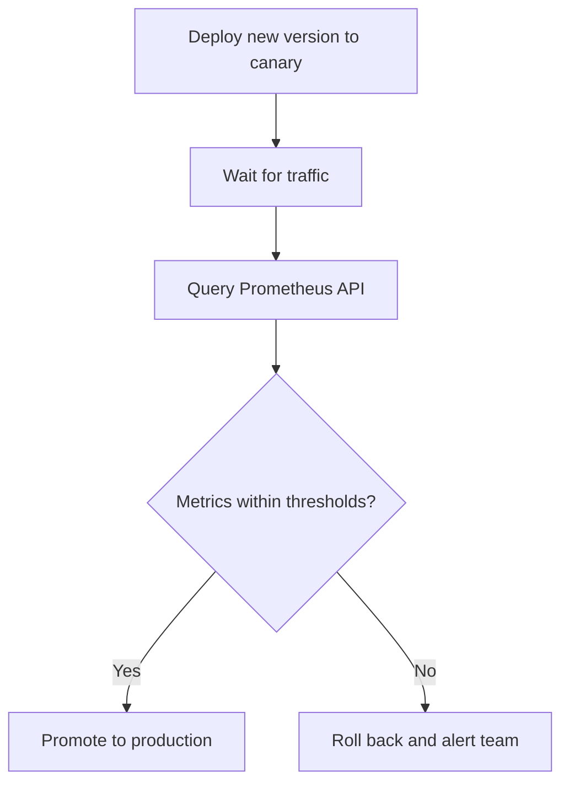

# Prometheus Integration with CI/CD

## Introduction

Monitoring your applications is just as important as deploying them. By integrating Prometheus with your Continuous Integration and Continuous Deployment (CI/CD) pipelines, you can automate monitoring setup alongside your application deployments. This ensures that every new release is automatically monitored, performance metrics are tracked across deployments, and any regressions are quickly identified.

In this guide, we'll explore how to seamlessly incorporate Prometheus monitoring into your CI/CD workflow, allowing you to build observability into your delivery pipeline rather than treating it as an afterthought.

## Understanding the Integration Points

Before diving into implementation, let's understand where Prometheus fits in a CI/CD pipeline:



Prometheus touches the pipeline in three places:

1. **Before deployment**: configuration files, alerting rules, and recording rules are validated just like application code.
2. **During deployment**: new services are registered as scrape targets, and their alerts and dashboards are rolled out together with the application.
3. **After deployment**: metrics from the new release are queried to verify its health, and the pipeline can block or roll back a bad release automatically.

## Treating Monitoring Configuration as Code

The foundation of CI/CD integration is keeping Prometheus configuration in version control next to (or alongside) your application code. A typical repository layout looks like this:

```text
monitoring/
├── prometheus.yml
├── rules/
│   ├── recording_rules.yml
│   └── alerts/
│       ├── api_alerts.yml
│       └── database_alerts.yml
└── tests/
    └── api_alerts_test.yml
```

With this layout, every change to monitoring goes through the same review, testing, and deployment process as an application change.

## Validating Configuration in CI

Prometheus ships with `promtool`, a command-line tool that can check configuration files and rule files for errors. Running it in CI prevents a broken configuration from ever reaching your Prometheus servers.

```bash
# Validate the main configuration file (also checks referenced rule files)
promtool check config monitoring/prometheus.yml

# Validate rule files on their own
promtool check rules monitoring/rules/*.yml monitoring/rules/alerts/*.yml
```

Both commands exit with a non-zero status when they find a problem, which makes the pipeline fail.

### Unit Testing Alerting Rules

`promtool` can also unit test alerting and recording rules against synthetic time series. Here is an alert rule:

```yaml
# monitoring/rules/alerts/api_alerts.yml
groups:
  - name: api-alerts
    rules:
      - alert: HighErrorRate
        expr: |
          sum(rate(http_requests_total{job="api", status=~"5.."}[5m]))
            /
          sum(rate(http_requests_total{job="api"}[5m])) > 0.05
        for: 5m
        labels:
          severity: critical
        annotations:
          summary: "API error rate above 5%"
```

And a test that feeds it data and checks that the alert fires:

```yaml
# monitoring/tests/api_alerts_test.yml
rule_files:
  - ../rules/alerts/api_alerts.yml

evaluation_interval: 1m

tests:
  - interval: 1m
    input_series:
      - series: 'http_requests_total{job="api", status="200"}'
        values: '0+90x20'
      - series: 'http_requests_total{job="api", status="500"}'
        values: '0+10x20'
    alert_rule_test:
      - eval_time: 15m
        alertname: HighErrorRate
        exp_alerts:
          - exp_labels:
              severity: critical
            exp_annotations:
              summary: "API error rate above 5%"
```

In this test, 10 out of every 100 requests fail, a 10% error rate, so the alert is expected to be firing at the 15-minute mark. Run the tests with:

```bash
promtool test rules monitoring/tests/*.yml
```

### Example: GitHub Actions Workflow

The following workflow validates configuration and runs rule tests on every pull request that touches the `monitoring/` directory. It uses the official `prom/prometheus` container image, which includes `promtool`:

```yaml
# .github/workflows/monitoring.yml
name: Validate Prometheus Configuration

on:
  pull_request:
    paths:
      - "monitoring/**"

jobs:
  validate:
    runs-on: ubuntu-latest
    steps:
      - uses: actions/checkout@v4

      - name: Check configuration
        run: |
          docker run --rm -v "$PWD/monitoring:/monitoring" --entrypoint promtool \
            prom/prometheus:latest check config /monitoring/prometheus.yml

      - name: Check rules
        run: |
          docker run --rm -v "$PWD/monitoring:/monitoring" --entrypoint sh \
            prom/prometheus:latest -c 'promtool check rules /monitoring/rules/*.yml /monitoring/rules/alerts/*.yml'

      - name: Test rules
        run: |
          docker run --rm -v "$PWD/monitoring:/monitoring" --entrypoint sh \
            prom/prometheus:latest -c 'promtool test rules /monitoring/tests/*.yml'
```

Pin the image to a specific Prometheus version in real pipelines so that results are reproducible.

## Deploying Monitoring Changes

Once changes are validated and merged, the CD pipeline needs to get them to the running Prometheus server.

### Reloading Prometheus

Prometheus can reload its configuration without restarting. You can either send it a `SIGHUP` signal or, if Prometheus was started with `--web.enable-lifecycle`, call the reload endpoint:

```bash
# Copy the validated files to the Prometheus server, then trigger a reload
curl -X POST http://prometheus.example.com:9090/-/reload
```

If the new configuration is invalid, Prometheus keeps running with the old configuration and logs an error, but validating in CI first avoids that situation entirely. Restrict access to the lifecycle endpoints, because anyone who can reach them can reload or shut down Prometheus.

### Kubernetes with the Prometheus Operator

On Kubernetes, the Prometheus Operator lets you ship monitoring configuration as Kubernetes resources in the same manifests or Helm chart as your application. A `ServiceMonitor` registers the service as a scrape target:

```yaml
apiVersion: monitoring.coreos.com/v1
kind: ServiceMonitor
metadata:
  name: api
  labels:
    release: prometheus
spec:
  selector:
    matchLabels:
      app: api
  endpoints:
    - port: http-metrics
      interval: 30s
```

A `PrometheusRule` resource carries the alerting rules:

```yaml
apiVersion: monitoring.coreos.com/v1
kind: PrometheusRule
metadata:
  name: api-alerts
  labels:
    release: prometheus
spec:
  groups:
    - name: api-alerts
      rules:
        - alert: HighErrorRate
          expr: |
            sum(rate(http_requests_total{job="api", status=~"5.."}[5m]))
              /
            sum(rate(http_requests_total{job="api"}[5m])) > 0.05
          for: 5m
          labels:
            severity: critical
```

The labels on these resources must match the selectors configured on your `Prometheus` resource. When the pipeline runs `kubectl apply` or `helm upgrade`, the operator picks up the changes and updates Prometheus automatically, so each release carries its own monitoring.

## Annotating Deployments

Correlating metric changes with deployments makes regressions much easier to spot. A simple approach is to expose build information as a metric from the application itself, a common convention in the Prometheus ecosystem:

```go
package main

import (
    "log"
    "net/http"

    "github.com/prometheus/client_golang/prometheus"
    "github.com/prometheus/client_golang/prometheus/promhttp"
)

// Set at build time, for example:
// go build -ldflags "-X main.version=1.4.2 -X main.commit=abc123"
var (
    version = "dev"
    commit  = "unknown"
)

func main() {
    buildInfo := prometheus.NewGaugeVec(
        prometheus.GaugeOpts{
            Name: "app_build_info",
            Help: "Build information about the running application.",
        },
        []string{"version", "commit"},
    )
    prometheus.MustRegister(buildInfo)
    buildInfo.WithLabelValues(version, commit).Set(1)

    http.Handle("/metrics", promhttp.Handler())
    log.Fatal(http.ListenAndServe(":8080", nil))
}
```

You can then join this metric with other queries or use it to mark version changes on dashboards:

```promql
# Number of running instances per version
count by (version) (app_build_info{job="api"})

# Error rate broken down by version
sum by (version) (
  rate(http_requests_total{job="api", status=~"5.."}[5m])
  * on (instance) group_left(version) app_build_info{job="api"}
)
```

## Automated Deployment Verification

The most powerful integration uses Prometheus as a quality gate. After deploying to staging or to a canary, the pipeline queries Prometheus through its HTTP API and fails if the metrics look unhealthy.

```bash
#!/usr/bin/env bash
# verify_deployment.sh - fail the pipeline if the error rate is too high
set -euo pipefail

PROMETHEUS_URL="${PROMETHEUS_URL:-http://prometheus.example.com:9090}"
THRESHOLD="0.01"
QUERY='sum(rate(http_requests_total{job="api",status=~"5.."}[5m])) / sum(rate(http_requests_total{job="api"}[5m]))'

# Give the new version time to receive traffic
sleep 300

ERROR_RATE=$(curl -s --get "${PROMETHEUS_URL}/api/v1/query" \
  --data-urlencode "query=${QUERY}" \
  | jq -r '.data.result[0].value[1] // "0"')

echo "Current error rate: ${ERROR_RATE}"

if awk -v rate="$ERROR_RATE" -v max="$THRESHOLD" 'BEGIN { exit !(rate > max) }'; then
  echo "Error rate ${ERROR_RATE} exceeds threshold ${THRESHOLD}. Failing deployment."
  exit 1
fi

echo "Deployment verified."
```

The script calls the `/api/v1/query` endpoint, extracts the value with `jq`, and compares it with the threshold using `awk` because the shell cannot compare floating-point numbers directly. A non-zero exit code stops the pipeline, and a later step can trigger a rollback.

The overall flow looks like this:



Progressive delivery tools such as Argo Rollouts and Flagger implement this pattern natively. They can run Prometheus queries during a canary rollout and abort automatically when a query fails its success condition.

## Monitoring the Pipeline Itself

CI/CD systems are production systems too. Many CI servers can expose Prometheus metrics, for example Jenkins through its Prometheus plugin and GitLab through its built-in metrics endpoint. Short-lived batch jobs that finish before Prometheus can scrape them can push results to the Pushgateway:

```bash
# Record the duration of a pipeline stage from inside a CI job
cat <<METRICS | curl --data-binary @- http://pushgateway.example.com:9091/metrics/job/ci_pipeline/stage/build
# TYPE ci_stage_duration_seconds gauge
ci_stage_duration_seconds 142
METRICS
```

Useful pipeline metrics include build duration, success and failure counts, queue time, and deployment frequency. Together these help you track delivery performance over time.

## Best Practices

- **Validate everything in CI.** Run `promtool check config`, `promtool check rules`, and `promtool test rules` on every change.
- **Version monitoring with the application.** Ship scrape configuration, alerts, and dashboards in the same release as the code they observe.
- **Pin tool versions.** Use the same Prometheus version in CI as in production to avoid surprises.
- **Use conservative quality gates.** Allow enough time and traffic for metrics to be meaningful before making a pass or fail decision.
- **Protect admin endpoints.** Limit access to `/-/reload` and other lifecycle endpoints.
- **Expose build information.** A `build_info` style metric makes it easy to compare versions.
- **Keep alert tests close to the rules.** Treat a rule without tests the same way you would treat code without tests.

## Summary

In this guide, you learned how to integrate Prometheus into CI/CD pipelines:

- Prometheus configuration and rules are managed as code in version control
- `promtool` validates configuration and unit tests alerting rules as part of CI
- Configuration changes can be deployed with the reload endpoint or, on Kubernetes, with Prometheus Operator resources such as `ServiceMonitor` and `PrometheusRule`
- Build information metrics connect metric changes to specific releases
- Deployment verification scripts and progressive delivery tools use Prometheus queries as automated quality gates
- The CI/CD system itself can be monitored with Prometheus

By building observability into the delivery pipeline, every release is monitored from the moment it is deployed, and regressions are caught before they affect all users.

## Exercises

1. Create a `monitoring/` directory for a sample application and add a configuration file, a recording rule, and an alert rule.
2. Write a `promtool` unit test that verifies your alert fires when the error rate is above the threshold and does not fire when it is below.
3. Set up a CI workflow that runs `promtool check config` and `promtool test rules` on every pull request.
4. Add an `app_build_info` metric to a sample service and write a PromQL query that shows how many instances run each version.
5. Write a deployment verification script that checks both error rate and 95th percentile latency before promoting a release.
6. Deploy a `ServiceMonitor` and `PrometheusRule` with a Helm chart for a sample application on a local Kubernetes cluster.

## Additional Resources

- [Prometheus configuration documentation](https://prometheus.io/docs/prometheus/latest/configuration/configuration/)
- [Unit testing for rules](https://prometheus.io/docs/prometheus/latest/configuration/unit_testing_rules/)
- [Prometheus HTTP API](https://prometheus.io/docs/prometheus/latest/querying/api/)
- [Prometheus Operator](https://prometheus-operator.dev/)
- [Pushgateway](https://github.com/prometheus/pushgateway)
